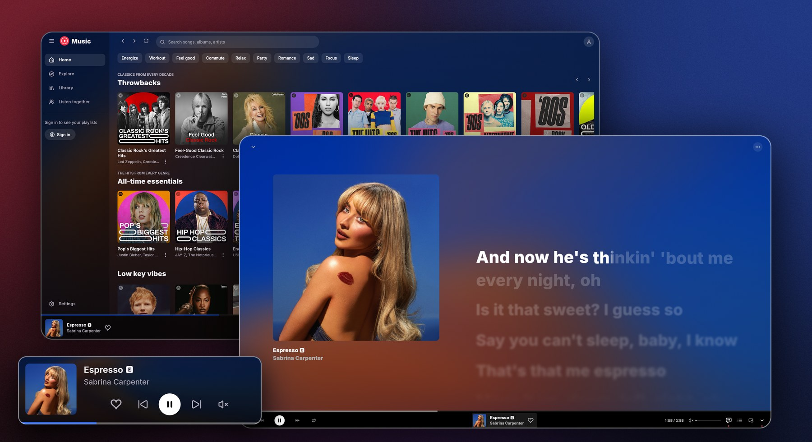
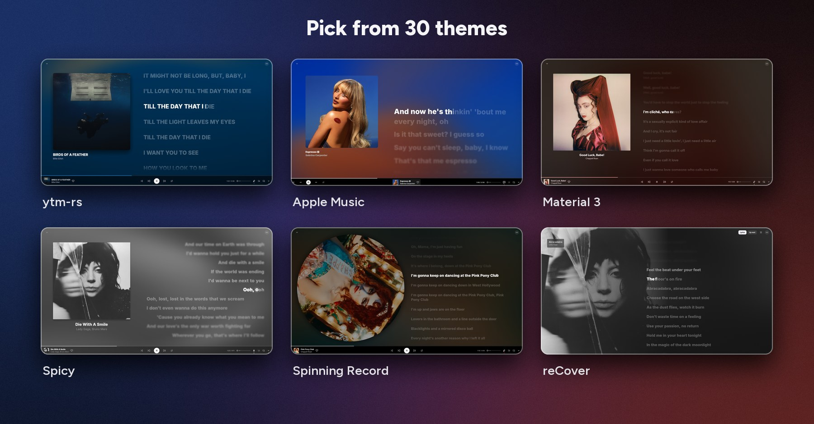
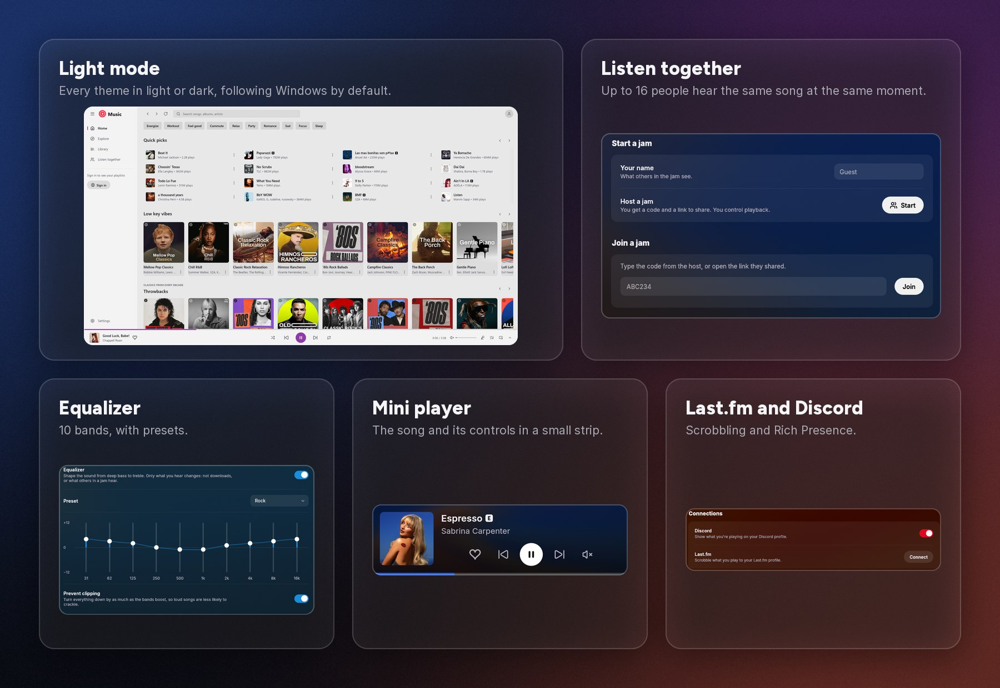

# RedSpotfy

> **YouTube Music, sem o navegador.**

Um cliente desktop nativo para YouTube Music escrito em Rust. Interface com egui,
áudio com rodio/symphonia e renderização opcional com wgpu — sem Electron, sem
aba oculta e sem pesadelo de RAM.

[](https://github.com/danilobrayann/redspotfy/releases/latest)
[](https://github.com/danilobrayann/redspotfy/releases)
[](https://github.com/danilobrayann/redspotfy/releases/latest)
[](LICENSE)

---

## O que é

A maioria dos "apps" de YouTube Music é o site rodando dentro de um Chromium
escondido. O RedSpotfy desenha cada pixel sozinho: UI nativa, player de áudio
nativo e ~130 MB de memória com uma música tocando — contra ~500 MB+ do site
no Chrome.

## Destaques

- **Player completo** — fila, rádio por música, shuffle, repeat, autoplay e
  crossfade, com prefetch da próxima faixa.
- **Letras em karaokê** — palavra por palavra, com romanização, tradução e
  ajustes de timing por música.
- **30 temas** — incluindo adaptações da comunidade Better Lyrics, modo
  claro/escuro e cores de destaque personalizadas.
- **Biblioteca real** — likes, playlists, histórico e uploads, direto da API
  web do YouTube Music.
- **Downloads** — salve músicas como `.m4a` com capa, na melhor qualidade que
  sua conta permite.
- **Listen together** — até 16 pessoas ouvindo a mesma música sincronizadas,
  via relay próprio em Cloudflare Workers.
- **Integrações** — scrobble para Last.fm e ListenBrainz, Rich Presence no
  Discord, transfer de playlists do Spotify.
- **Desktop de verdade** — controles de mídia do sistema, bandeja, atalhos
  globais de mídia, mini player, notificações e atualizações automáticas.

## Screenshots

<p align="center">
  
</p>

<p align="center">
  
</p>

<p align="center">
  
</p>

## Instalação

Baixe o instalador na página de [releases](https://github.com/danilobrayann/redspotfy/releases) — **todas as versões publicadas** estão lá, com link direto de download para cada arquivo. O app se atualiza sozinho; para desativar ou usar builds nightly, vá em **Settings › About › Updates**.

### Download direto — última versão

| Plataforma | Arquivo | Link |
| --- | --- | --- |
| Windows (Intel/AMD) | `redspotfy-setup-<versão>.exe` | [Baixar](https://github.com/danilobrayann/redspotfy/releases/latest/download/redspotfy-setup.exe) |
| Windows (ARM) | `redspotfy-setup-<versão>-arm64.exe` | [Baixar](https://github.com/danilobrayann/redspotfy/releases/latest/download/redspotfy-setup-arm64.exe) |
| macOS (Apple Silicon) | `redspotfy-setup-<versão>-macos-aarch64.dmg` | [Baixar](https://github.com/danilobrayann/redspotfy/releases/latest/download/redspotfy-setup-macos-aarch64.dmg) |
| macOS (Intel) | `redspotfy-setup-<versão>-macos-x86_64.dmg` | [Baixar](https://github.com/danilobrayann/redspotfy/releases/latest/download/redspotfy-setup-macos-x86_64.dmg) |
| Linux (.deb) | `redspotfy_<versão>_amd64.deb` | [Baixar](https://github.com/danilobrayann/redspotfy/releases/latest/download/redspotfy_amd64.deb) |
| Linux (.tar.gz) | `redspotfy-<versão>-linux-x86_64.tar.gz` | [Baixar](https://github.com/danilobrayann/redspotfy/releases/latest/download/redspotfy-linux-x86_64.tar.gz) |

> O executável ainda se chama `redspotfy` por enquanto — é o nome interno do
> projeto herdado do fork original.

**Linux (script):**

```sh
curl -fsSL https://raw.githubusercontent.com/danilobrayann/redspotfy/main/linux/install.sh | sh
```

## Compilando do código-fonte

Pré-requisito: [Rust](https://rustup.rs/).

```sh
git clone https://github.com/danilobrayann/redspotfy.git
cd redspotfy
cargo build --release
```

- **Linux** precisa antes de `libgtk-3-dev`, `libwebkit2gtk-4.1-dev`,
  `libasound2-dev` e `pkg-config` (veja o `flake.nix` para Nix).
- O relay do "Listen together" fica em `server/` (Cloudflare Worker em Rust);
  você não precisa dele para compilar o app, que usa o relay hospedado.

## Privacidade

O RedSpotfy não coleta telemetria nem dados de uso. Toda a comunicação é com
os serviços que você mesmo conecta (YouTube Music, Last.fm, Discord etc.).
Veja [PRIVACY.md](PRIVACY.md) para a lista completa.

## Avisos

- Projeto não-oficial e sem afiliação com Google, YouTube ou Spotify.
- Requer conta Google para recursos de biblioteca; streaming usa os mesmos
  endpoints do music.youtube.com.
- Musicas com restrição de idade podem depender de Premium ou de `yt-dlp`.
- Mudanças no YouTube Music podem quebrar partes do app — contribuições e
  issues são bem-vindas.

## Créditos

Interface com [egui](https://github.com/emilk/egui) · áudio com
[rodio](https://github.com/RustAudio/rodio) + Symphonia · letras inspiradas no
[Better Lyrics](https://github.com/better-lyrics) · temas da comunidade
Better Lyrics · relay com [workers-rs](https://github.com/cloudflare/workers-rs).

Fork de [redspotfy](https://github.com/danilobrayann/redspotfy).

## Licença

[GPL-3.0](LICENSE)
